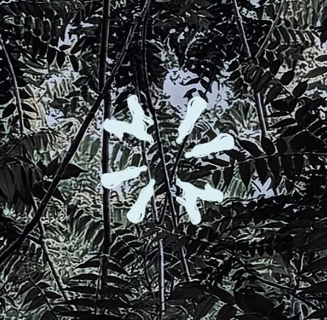

# Arafat Onimisi Suleiman — Portfolio

A static, zero-build portfolio site. Plain HTML, CSS and vanilla JavaScript — no
dependencies, no toolchain, no install step. Just open `index.html` in a browser.

## Preview locally

**Easiest:** open `index.html` directly in your browser (or right-click →
"Open with Live Server" in VSCodium).

**Or serve it properly** (recommended, matches production URLs):

```bash
python3 -m http.server 8000
# then visit http://localhost:8000
```

## Structure

```
index.html                  all page content
404.html                    custom not-found page
assets/css/styles.css       design tokens + all styles
assets/js/main.js           theme toggle, nav, scroll reveals, counters
assets/img/                 put images here (portrait, project shots, og-cover.jpg)
.github/workflows/deploy.yml  auto-deploy to GitHub Pages on push to main
```

## Deploying (GitHub Pages)

Every push to `main` triggers the workflow in `.github/workflows/deploy.yml`,
which publishes the site. One-time setup in the repo:

1. **Settings → Pages**
2. Under **Build and deployment → Source**, choose **GitHub Actions**
3. Push to `main` (or run the workflow manually from the **Actions** tab)

Live URL: `https://comradeonboard.github.io/arafat-onimisi-portfolio/`

## Editing content

Every section that still needs real content is marked with a comment:

```html
<!-- TODO(content): ... -->
```

Search for `TODO` across the project to find them all. See `TODO-CONTENT.md` for a
checklist.

## Adding images

Drop files into `assets/img/` and reference them relatively:

```html

```

For the social preview image, add `assets/img/og-cover.jpg` (1200×630 is ideal).

## Notes

- Dark theme by default, with a light-mode toggle (remembered per visitor).
- Respects `prefers-reduced-motion` and works without JavaScript.
- No external JS libraries. Fonts load from Google Fonts with system fallbacks.
